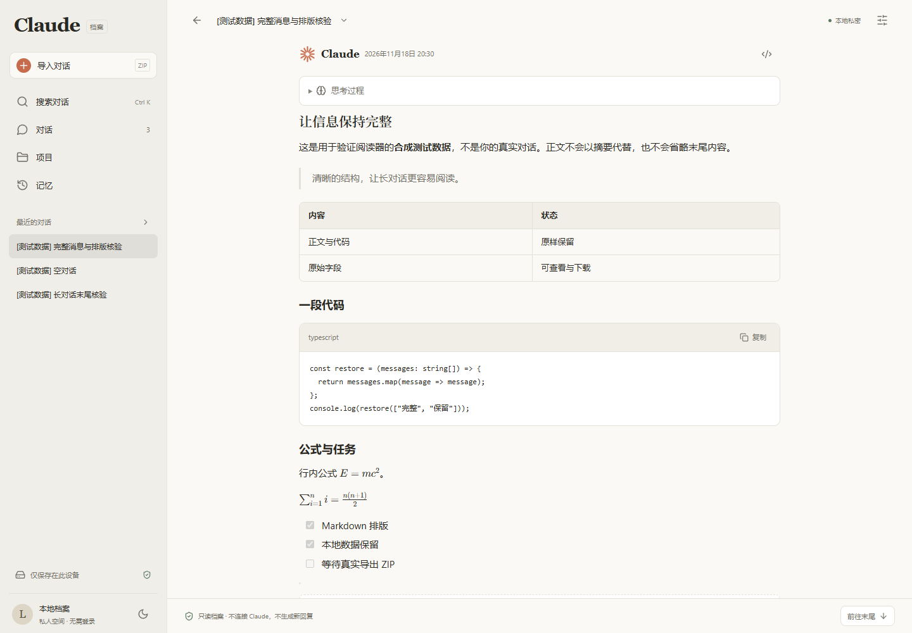
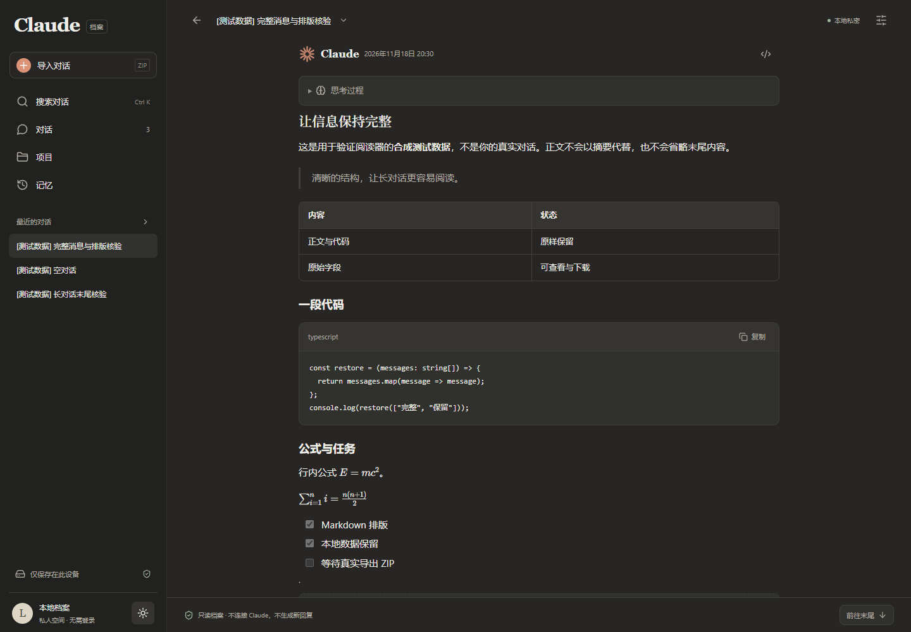
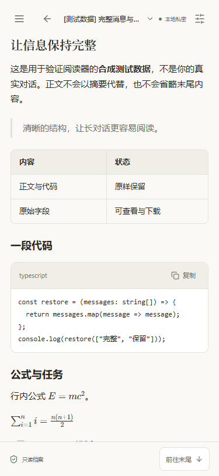

# Claude 对话档案

一个 Claude 风格、本地优先的对话档案阅读器。导入导出包，按原始顺序阅读消息，查看代码、公式、工具记录和附件，再按需生成只读分享快照。

**不连接 Claude，不生成新回复，不需要 API Key。非 Anthropic 官方项目。**

[快速开始](#快速开始) · [导入档案](#导入档案) · [只读分享](#只读分享) · [测试](#测试) · [常见问题](#常见问题)

## 界面预览

以下截图均由**明确标记的合成测试数据**生成，不包含作者的真实对话或账户信息。

### 桌面阅读



<details>
<summary>查看深色界面与手机布局</summary>





</details>

## 能做什么

| 能力 | 实际行为 |
| --- | --- |
| ZIP / JSON 导入 | 支持一次选择多个对话、记忆、元数据或附件包；导入失败不保存本次内容 |
| 完整消息阅读 | 按导出顺序展示全部消息；保留导出中存在的分支，不用摘要替代正文 |
| Markdown 排版 | 支持代码块、表格、任务列表、脚注与 KaTeX 公式 |
| 原始字段保留 | 可展开思考块、工具调用、工具返回与未知类型，查看和下载完整原始 JSON |
| 附件阅读 | 使用导入包内的文件；可下载原始文件、查看提取文本，明确提示缺失附件 |
| 全文搜索 | 搜索标题和原始字段，包括代码与工具内容；支持当前对话内定位 |
| 收藏与排序 | 收藏对话，按更新时间或标题排序 |
| 导出与备份 | 导出单段原始 JSON、含原始消息的 Markdown，或全部对话 JSON；重新下载原始导入文件 |
| 安全静态预览 | 查看 HTML / SVG Artifact 源码；隔离预览不执行脚本，因此不还原交互功能 |
| 本地 / 分享两种模式 | 默认本地导入阅读；可另行构建一个无需访客导入的只读快照 |
| 适配与主题 | 支持浅色、深色和手机 / 平板 / 桌面布局 |

> “完整”指保留导出包实际提供的内容。未导出的消息、删除记录、缺失附件或上游已经截断的正文，无法凭空恢复。

## 快速开始

### 环境

- Node.js 22.12+，推荐 Node.js 24；Vite 也支持 Node.js 20.19+。
- npm 和 Git。
- 允许使用 IndexedDB 的现代浏览器。
- Microsoft Edge 仅是当前浏览器测试脚本的要求，不是日常阅读的唯一浏览器。

```bash
git clone https://github.com/072529-aaa/claude-conversation-archive.git
cd claude-conversation-archive
npm ci
npm run dev
```

打开终端显示的本地地址，默认是 `http://127.0.0.1:5173/`。运行期间保留终端窗口。

### 使用构建版

```bash
npm run build
npm run preview
```

默认预览地址为 `http://127.0.0.1:4173/`。不要直接双击 `dist/index.html`；请使用 HTTP 服务器预览。

Windows 也可以双击根目录的 `打开对话档案.cmd`：首次运行会安装依赖并构建，随后打开本地预览。源码更新后请先重新执行 `npm run build`，启动脚本不会自动重建已经存在的 `dist/`。

## 导入档案

1. 在 Claude 中申请导出数据，下载**真正的 ZIP / JSON 文件**。
2. 打开本地页面，点击“选择文件”或“导入对话”，也可以拖入文件。
3. 先导入 `conversations` 对话包；如果导出还包含 `memories`、`light_metadata` 或附件包，可以一起选择。
4. 在“档案与完整性”中核对来源、对话数和消息数，再开始阅读。
5. 请另行备份原始导出包；浏览器数据库不是永久备份。

### 支持的 JSON 结构

可识别对话数组、单段对话，以及 `conversations`、`chats`、`data`、`items`、`chat_conversations` 等包装字段。消息列表支持 `chat_messages`，或带对话标识的 `messages`。

记忆和元数据按原始 JSON 保留与查看，不会生成新的记忆或伪造项目内容。

### 导入边界

- `manifest*.json` 是下载清单，不是正文。应用不会自动访问其中可能带有账户凭据的下载链接。
- 单个输入文件上限为 512 MB；每个 ZIP 解压后单文件上限为 256 MB、总计上限为 1 GB。
- 非有效 JSON、伪装成 ZIP 的 HTML 页面、超限文件会报错，不保存本次导入。
- 完全相同的对话去重；同一标识但内容不同的版本分别保留，不覆盖旧记录。
- 包内同路径、同 SHA-256 的附件去重；没有提供原始文件的附件只保留引用和缺失提示。

## 本地数据与隐私

本地模式下，导入文件由浏览器读取，档案保存在当前站点的 IndexedDB；主题和收藏保存在 localStorage。无需登录，也不会将导入档案上传到服务器。

- 换浏览器、浏览器配置、设备、域名或端口，不会自动同步已有档案。
- 清理站点数据、使用不保留存储的隐私窗口，或触发存储空间限制，都会影响档案保存。
- 原始 JSON、导出的 Markdown 和附件仍可能包含个人信息，请妥善保管。
- 外部图片不会自动联网加载；主动点击正文中的外部链接会打开第三方网站。
- 页面和字体来自项目构建产物；首次安装依赖需要联网。本项目不是账户同步服务，也未提供浏览器存储加密。

仓库只包含源码、配置、合成数据生成器和合成截图。原始档案、分享快照、构建产物、环境文件与本地部署描述不提交到 Git。

## 只读分享

**本地页面链接不会携带浏览器档案。** 要让别人直接阅读，需要单独构建快照并部署静态文件；`localhost` 和 `127.0.0.1` 地址不能作为公网分享链接。

| | 默认本地模式 | 分享模式 |
| --- | --- | --- |
| 数据来源 | 当前浏览器导入的文件 | 构建时选择的 JSON 快照 |
| 访客导入 | 支持 | 不提供 |
| 数据存储 | 当前浏览器 IndexedDB | 托管站点的静态 JSON |
| 查看 / 下载 | 本地浏览器用户 | 能访问托管站点的访客 |
| 自动同步后续导入 | 不支持 | 不支持 |

### 1. 准备已审核的对话快照

从“档案与完整性”导出全部对话 JSON，选择要公开的记录，将对话数组放在 `conversations` 字段内。创建 `downloads/` 目录，并保存为 `downloads/shared-conversations-source.json`。

下面是一份可以直接试用的**合成示例**，不是实际用户档案：

```json
{
  "conversations": [
    {
      "uuid": "demo-conversation",
      "name": "[合成示例] 欢迎阅读",
      "chat_messages": [
        {
          "uuid": "demo-human",
          "sender": "human",
          "text": "请展示这段合成测试对话。"
        },
        {
          "uuid": "demo-assistant",
          "sender": "assistant",
          "text": "这是一份只读档案示例，不包含真实账户数据。"
        }
      ]
    }
  ]
}
```

### 2. 构建并检查

```bash
npm run build:shared
npm run preview:shared
```

在 `http://127.0.0.1:4174/` 检查对话、消息末尾、原始 JSON 和下载行为。分享模式开发预览使用 `npm run dev:shared`，但同样需要先构建上述快照。

### 3. 部署静态输出

将 **`dist-shared/` 内的文件**部署到所选静态托管服务，并检查 HTTPS、访问权限、匿名浏览和刷新后的深链接。不要上传整个项目、`downloads/` 或原始 ZIP。

### 发布前必须知道

- 分享脚本只移除每段对话顶层的 `account` 字段，**不做全面自动脱敏**。消息、工具返回、附件引用和其他原始字段仍可能包含姓名、联系方式、凭据或第三方隐私。
- 独立记忆、登录历史、账户资料不要放进待公开的对话快照；脚本不能替代人工内容审核。
- 公开托管的 JSON 可以被直接下载。“只读”只表示网页不修改快照，不代表无法复制内容。
- `noindex` / `nofollow` / `noarchive` 只是搜索引擎请求，**不是访问控制**。需要私密分享时，必须由托管服务提供认证和权限。
- 当前分享构建只打包对话 JSON 和应用资源，不会自动打包本地 IndexedDB 中的二进制附件；缺失附件会明确提示。
- 发布后是一个固定快照，发布者在本地继续导入数据不会自动更新它。

## 测试

```bash
npm run build
npm test
npm run test:fixtures
```

启动默认本地开发服务后，在另一个终端运行：

```bash
npm run test:browser
```

浏览器脚本使用已安装的 Microsoft Edge（Playwright `msedge` 通道）。测试在独立浏览器上下文中导入合成数据，不修改日常浏览器的档案。

测试基线：**10 项完整性测试、13 组浏览器检查**。合成样本包含 3 段对话、126 条消息，其中一段有 121 条消息，用于验证末尾没有遗漏。

覆盖导入错误、去重与版本保留、原始字段、代码与公式、工具与未知块、附件下载、脚注路由、静态 Artifact 隔离、搜索、收藏持久化、空对话及多尺寸布局；浏览器测试同时检查页面异常与外部 HTTP 请求。

截图和结果生成在 `tests/screenshots/`，不自动提交；首页展示的截图是人工检查后选取的合成样本。使用其他端口时，可通过 `ARCHIVE_URL` 指定测试地址：

```bash
# Git Bash / macOS / Linux
ARCHIVE_URL="http://127.0.0.1:5180/" npm run test:browser
```

```powershell
# PowerShell
$env:ARCHIVE_URL = "http://127.0.0.1:5180/"
npm run test:browser
```

依赖检查：

```bash
npm audit --omit=dev
npm audit
```

生产依赖审计与包含开发工具的完整审计不是同一范围；审计结果也不等于完整安全保证。不要为消除告警盲目执行 `npm audit fix --force`。

## 常见问题

**导入后显示零段对话？** 先确认选择的不是下载清单、记忆包或仅含元数据的 ZIP。必须提供对话 JSON；附件包单独导入不会生成对话。

**下载的是 ZIP，为什么提示无效？** 文件可能实际是登录页、地区限制页或过期链接返回的 HTML。重新获取真实导出，不要只修改扩展名。

**换端口后对话不见了？** 浏览器存储按来源隔离，开发端口和预览端口是不同空间。回到原来的浏览器与地址，或重新导入备份。

**启动提示端口占用？** 不要结束不明进程；使用 `npm run dev -- --port 5180` 或 `npm run preview -- --port 4176`，以终端实际地址为准。

**`build:shared` 提示找不到源 JSON？** 分享数据不随源码仓库提供。按“只读分享”章节创建指定文件，确保根对象包含非空的 `conversations` 数组。

**为什么 Artifact 或外部图片与原页面不同？** 静态预览有意禁用脚本和网络；缺失资源不会自动补全。可查看源码或下载原始文件，在理解风险后另行使用。

**大量对话是否保证流畅？** 当前对话会渲染全部消息；超大档案可能受浏览器内存和存储配额限制，文件大小上限不是性能保证。

## 项目结构

```text
src/
  App.tsx                   导入、搜索、主题、导出与阅读工作区
  components/Message.tsx    消息、Markdown、工具块与附件渲染
  components/Modal.tsx      弹窗
  lib/archive.ts            解析、归一化、合并与导出
  lib/storage.ts            IndexedDB 本地持久化
  lib/shared.ts             只读快照加载
scripts/package-shared.mjs  分享输出打包
tests/                     完整性与浏览器测试、合成数据生成器
docs/images/               经检查的合成展示截图
```

技术栈：React 19、TypeScript、Vite 7、fflate、idb、react-markdown、KaTeX、Lucide、Vitest 和 Playwright。依赖版本以 `package-lock.json` 为准。

## 问题反馈与贡献

欢迎提交功能问题、复现步骤和针对性的改进。请使用最小合成 JSON / ZIP 复现，并说明浏览器、Node.js 版本和实际结果；**不要在公开 Issue、PR 或截图中上传真实导出、下载清单链接、凭据和个人消息**。

修改消息解析或展示时，请同时验证原始字段保留、长消息末尾、未知块和缺失附件。提交前运行构建及相关测试。

当前仓库尚未声明项目开源许可证。公开可见不等于已获得任意复制、修改或再分发授权；第三方依赖继续遵循各自许可证。
